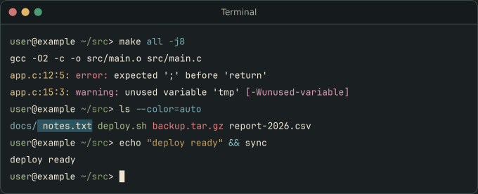

# Everslate

## Terminal ANSI 16

**Normal**

<table align="center">
<tr>
    <th>0</th>
    <th>1</th>
    <th>2</th>
    <th>3</th>
    <th>4</th>
    <th>5</th>
    <th>6</th>
    <th>7</th>
</tr>
    <td align="center"> <code>#596257</code></td>
    <td align="center"> <code>#4B9E74</code></td>
    <td align="center"> <code>#819B69</code></td>
    <td align="center"> <code>#CD9E50</code></td>
    <td align="center"> <code>#4196C7</code></td>
    <td align="center"> <code>#9583B8</code></td>
    <td align="center"> <code>#79A9B8</code></td>
    <td align="center"> <code>#EDE6D5</code></td>
</table>

**Bright**

<table align="center">
<tr>
    <th>8</th>
    <th>9</th>
    <th>10</th>
    <th>11</th>
    <th>12</th>
    <th>13</th>
    <th>14</th>
    <th>15</th>
</tr>
    <td align="center"> <code>#7A8478</code></td>
    <td align="center"> <code>#E67E80</code></td>
    <td align="center"> <code>#A7C080</code></td>
    <td align="center"> <code>#DBC07F</code></td>
    <td align="center"> <code>#7FBBB3</code></td>
    <td align="center"> <code>#D699B6</code></td>
    <td align="center"> <code>#8FC8DA</code></td>
    <td align="center"> <code>#F8F5E5</code></td>
</table>

### Terminal example

### Install

**iTerm2** (and anything that imports `.itermcolors`): Settings → Profiles → Colors → Color Presets → Import… and pick [`everslate.itermcolors`](./everslate.itermcolors). Many other terminals and tools accept this format directly or through converters.

## Editor & UI palette

### Backgrounds & UI

<table align="center">
<tr>
    <th>Preview</th>
    <th>Role</th>
    <th>Hex</th>
    <th>RGB</th>
</tr>
<tr>
    <td></td>
    <td><code>Background</code></td>
    <td><code>#1A1F21</code></td>
    <td><code>rgb(26, 31, 33)</code></td>
</tr>
<tr>
    <td></td>
    <td><code>Deep background</code></td>
    <td><code>#111619</code></td>
    <td><code>rgb(17, 22, 25)</code></td>
</tr>
<tr>
    <td></td>
    <td><code>Panel</code></td>
    <td><code>#151A1C</code></td>
    <td><code>rgb(21, 26, 28)</code></td>
</tr>
<tr>
    <td></td>
    <td><code>Elevated background</code></td>
    <td><code>#22292C</code></td>
    <td><code>rgb(34, 41, 44)</code></td>
</tr>
<tr>
    <td></td>
    <td><code>Active</code></td>
    <td><code>#273034</code></td>
    <td><code>rgb(39, 48, 52)</code></td>
</tr>
<tr>
    <td></td>
    <td><code>Selection</code></td>
    <td><code>#2C5561</code></td>
    <td><code>rgb(44, 85, 97)</code></td>
</tr>
<tr>
    <td></td>
    <td><code>Selection (strong)</code></td>
    <td><code>#336C7D</code></td>
    <td><code>rgb(51, 108, 125)</code></td>
</tr>
<tr>
    <td></td>
    <td><code>Border</code></td>
    <td><code>#384748</code></td>
    <td><code>rgb(56, 71, 72)</code></td>
</tr>
<tr>
    <td></td>
    <td><code>Border (strong)</code></td>
    <td><code>#4F6163</code></td>
    <td><code>rgb(79, 97, 99)</code></td>
</tr>
<tr>
    <td></td>
    <td><code>Deep slate (fill)</code></td>
    <td><code>#2A3B40</code></td>
    <td><code>rgb(42, 59, 64)</code></td>
</tr>
</table>

### Text

<table align="center">
<tr>
    <th>Preview</th>
    <th>Role</th>
    <th>Hex</th>
    <th>RGB</th>
</tr>
<tr>
    <td></td>
    <td><code>Foreground</code></td>
    <td><code>#EDE6D5</code></td>
    <td><code>rgb(237, 230, 213)</code></td>
</tr>
<tr>
    <td></td>
    <td><code>Muted</code></td>
    <td><code>#A6B0A0</code></td>
    <td><code>rgb(166, 176, 160)</code></td>
</tr>
<tr>
    <td></td>
    <td><code>Comment</code></td>
    <td><code>#859289</code></td>
    <td><code>rgb(133, 146, 137)</code></td>
</tr>
<tr>
    <td></td>
    <td><code>Faint</code></td>
    <td><code>#7A8478</code></td>
    <td><code>rgb(122, 132, 120)</code></td>
</tr>
<tr>
    <td></td>
    <td><code>Terminal bold</code></td>
    <td><code>#DBBC7F</code></td>
    <td><code>rgb(219, 188, 127)</code></td>
</tr>
</table>

### Accents

<table align="center">
<tr>
    <th>Preview</th>
    <th>Role</th>
    <th>Hex</th>
    <th>RGB</th>
</tr>
<tr>
    <td></td>
    <td><code>Primary (slate)</code></td>
    <td><code>#79A9B8</code></td>
    <td><code>rgb(121, 169, 184)</code></td>
</tr>
<tr>
    <td></td>
    <td><code>Keyword</code></td>
    <td><code>#4B9E74</code></td>
    <td><code>rgb(75, 158, 116)</code></td>
</tr>
<tr>
    <td></td>
    <td><code>String</code></td>
    <td><code>#819B69</code></td>
    <td><code>rgb(129, 155, 105)</code></td>
</tr>
<tr>
    <td></td>
    <td><code>Function</code></td>
    <td><code>#66A5AD</code></td>
    <td><code>rgb(102, 165, 173)</code></td>
</tr>
<tr>
    <td></td>
    <td><code>Number</code></td>
    <td><code>#4196C7</code></td>
    <td><code>rgb(65, 150, 199)</code></td>
</tr>
<tr>
    <td></td>
    <td><code>Operator</code></td>
    <td><code>#B77E64</code></td>
    <td><code>rgb(183, 126, 100)</code></td>
</tr>
<tr>
    <td></td>
    <td><code>Special (gold)</code></td>
    <td><code>#E5B567</code></td>
    <td><code>rgb(229, 181, 103)</code></td>
</tr>
<tr>
    <td></td>
    <td><code>Red (error & meter)</code></td>
    <td><code>#CF7677</code></td>
    <td><code>rgb(207, 118, 119)</code></td>
</tr>
</table>

